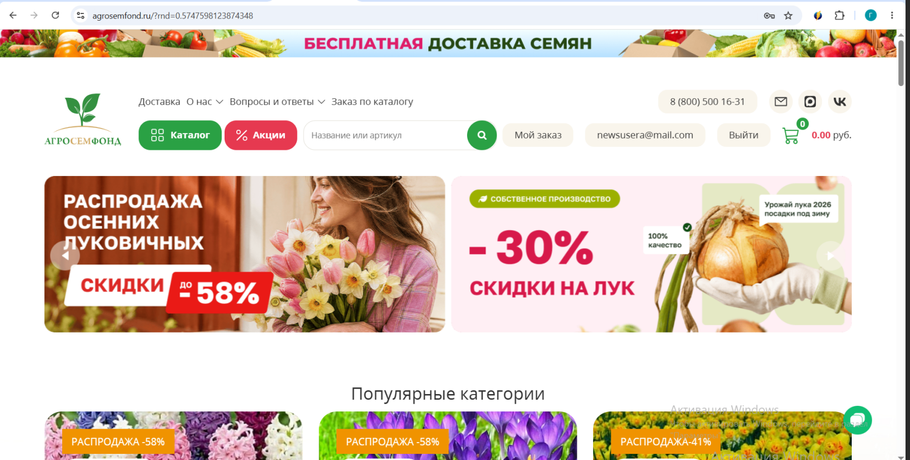
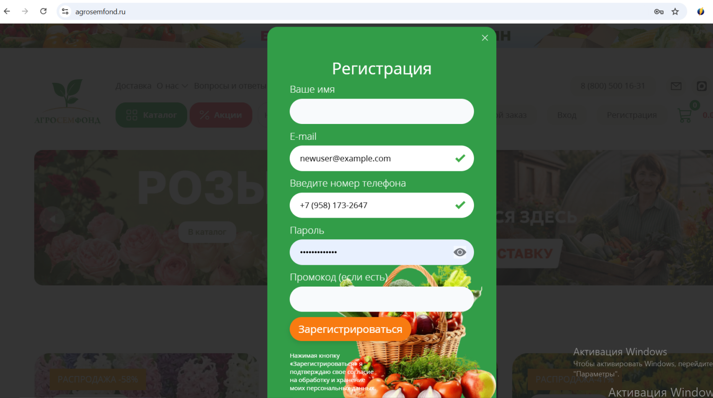
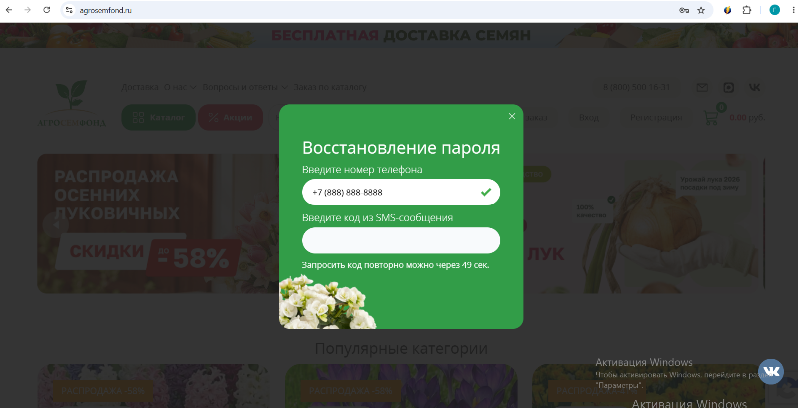

# Проект 1: E-commerce (Plant Shop) - Регистрация и Авторизация

**Задача:** Провести функциональное тестирование всех форм, связанных с созданием аккаунта, входом и восстановлением доступа.

## Что проверялось:
* Валидация обязательных полей (Имя, E-mail, Телефон, Пароль).
* Обработка невалидных данных (буквы в телефоне, email без @).
* Логика восстановления пароля.
* Работа UI-элементов (переключатель видимости пароля).

## Найденные баги:
1. **BR-001 (Critical):** Отсутствие валидации обязательного поля «Ваше имя». Форма успешно регистрирует пользователя с пустым полем.
   

2. **BR-002 (Minor):** Не работает переключатель видимости пароля (иконка «Глаз»). При клике пароль не отображается в виде текста.
   

3. **BR-003 (Major):** Отсутствие проверки существования пользователя при восстановлении пароля. Система имитирует успешную отправку SMS на незарегистрированный номер.
   

## 📊 Материалы:
* [Скачать полный отчет (Test-Case, Run, Bug report)](./agrosemfond_report.xlsx)
