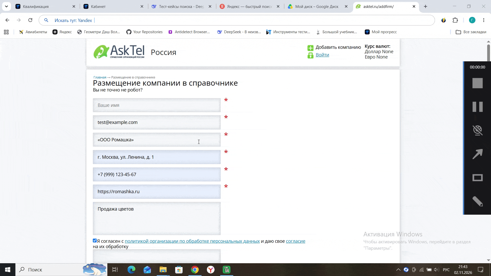
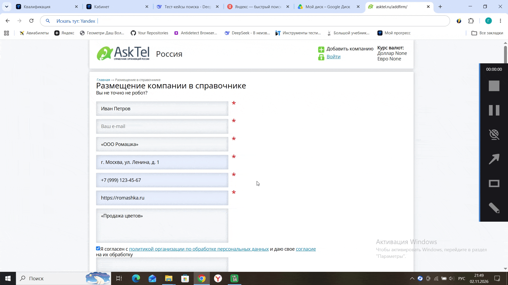
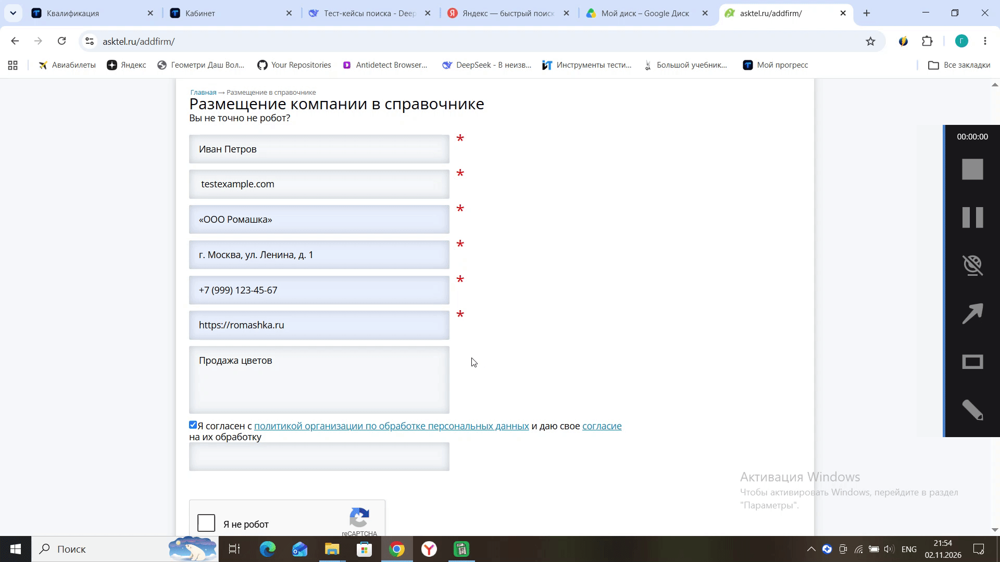
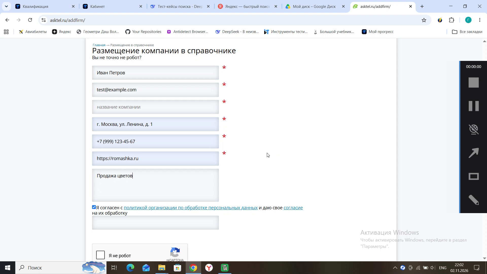
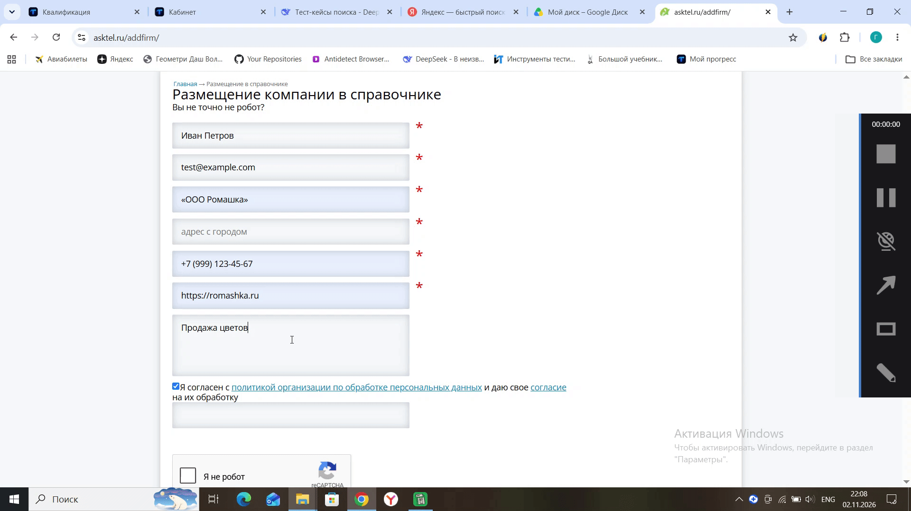
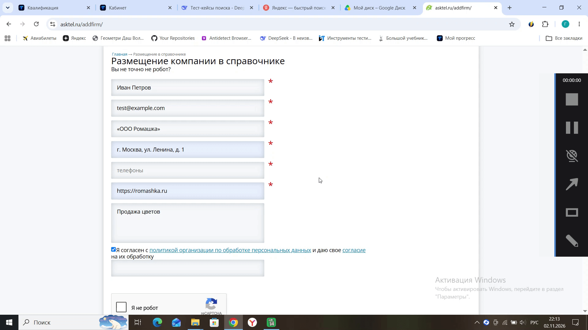
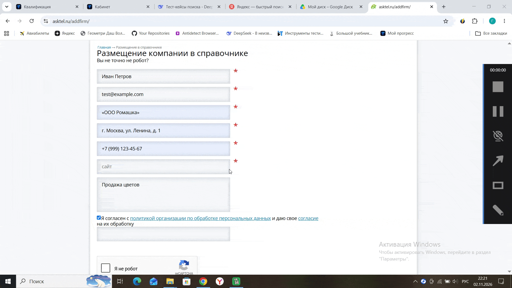
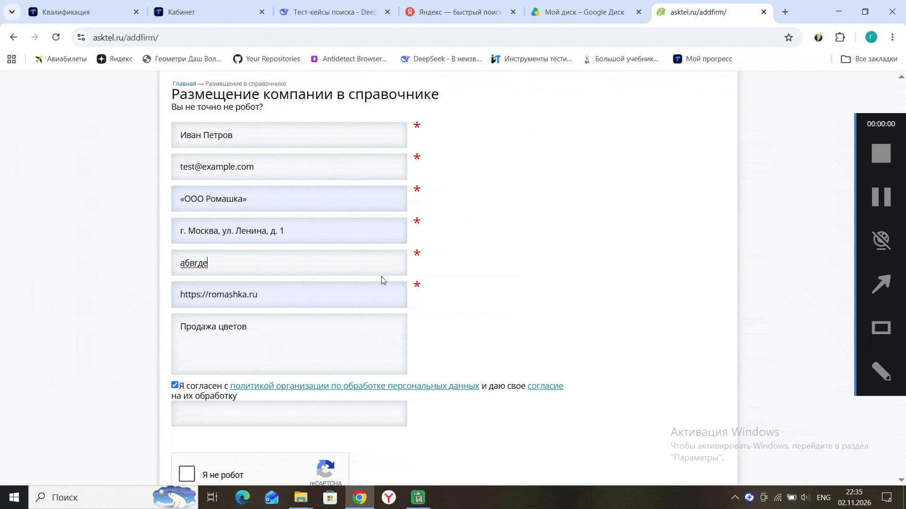

# Проект 2: B2B Каталог - Форма добавления компании

**Задача:** Глубокое негативное тестирование формы добавления новой компании. Проверка обработки невалидных данных и обязательных полей.

## Что проверялось:
* Валидация обязательных полей (Имя, E-mail, Название компании, Адрес, Телефон, Сайт).
* Обработка невалидных форматов данных (email без @, буквы вместо цифр в телефоне, некорректный URL).
* Работа обязательных чекбоксов и reCAPTCHA.

## Найденные баги (10 шт.):

1. **BR-001 (Major):** Отсутствие валидации поля «Ваше имя». Форма отправляется с пустым полем.
   

2. **BR-002 (Major):** Отсутствие валидации поля «Ваш e-mail». Форма отправляется с пустым полем.
   

3. **BR-003 (Major):** Отсутствие проверки формата email (принимает текст без @).
   

4. **BR-004 (Major):** Отсутствие валидации поля «Название компании».
   

5. **BR-005 (Major):** Отсутствие валидации поля «Адрес с городом».
   

6. **BR-006 (Major):** Отсутствие валидации поля «Телефоны».
   

7. **BR-007 (Major):** Отсутствие валидации поля «Сайт».
   

8. **BR-008 (Major):** Сброс данных и некорректное сообщение («Вы не точно не робот?») при непройденной reCAPTCHA.
   

9. **BR-009 (Major):** Отсутствие проверки формата телефона (принимает буквы).
   

10. **BR-010 (Major):** Отсутствие проверки формата URL (принимает просто текст).
    .gif)

## 📊 Материалы:
* [Скачать полный отчет (Test-Case, Run, Bug report)](./asktel_report.xlsx)
