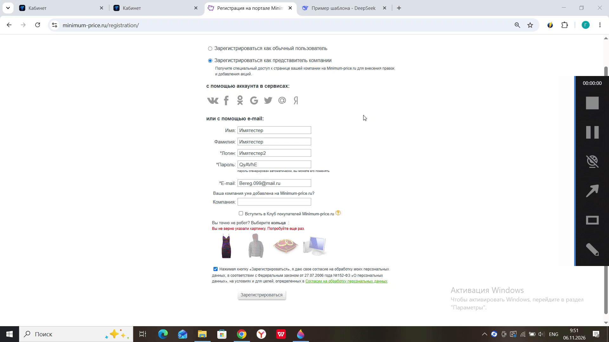
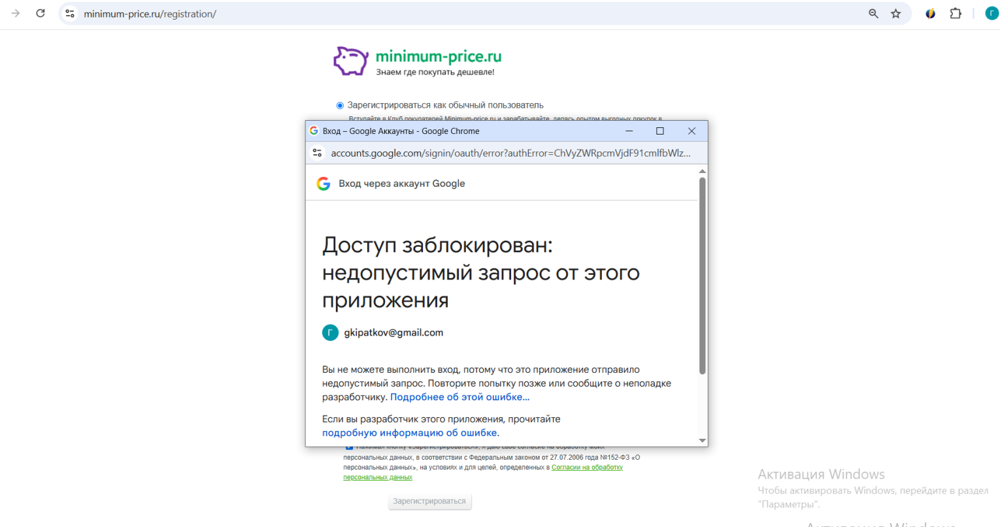
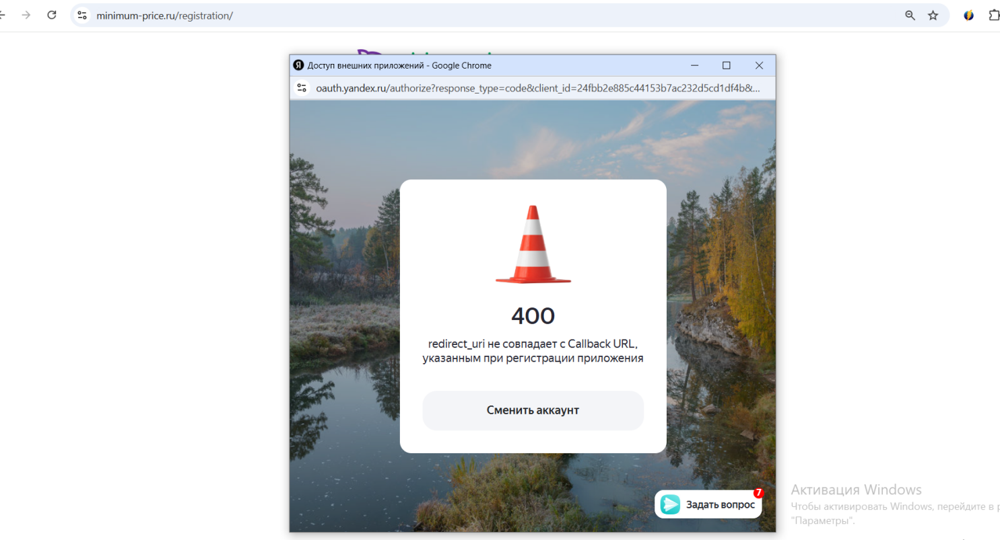

# Проект 3: Маркетплейс - Роли и OAuth-интеграция

**Задача:** Тестирование регистрации разных типов пользователей (Обычный пользователь, Представитель компании) и интеграции с внешними сервисами авторизации.

## Что проверялось:
* Валидация полей для разных ролей (включая специфичные поля вроде «Компания»).
* Работа обязательных чекбоксов и капчи.
* Интеграция с OAuth-провайдерами (ВКонтакте, Google, Mail.ru, Яндекс).

## Найденные баги:
1. **BR-001 (Major):** Отсутствует проверка обязательности поля «Компания» при регистрации представителя. Регистрация проходит успешно без указания компании.
   

2. **BR-002 (Critical):** Ошибка 400 (redirect_uri_mismatch) при попытке регистрации/авторизации через Google и Яндекс. Функционал полностью нерабочий из-за неверных настроек Callback URL.
   
   

## 📊 Материалы:
* [Скачать полный отчет (Test-Case, Run, Bug report)](./minimum_price_report.xlsx)
