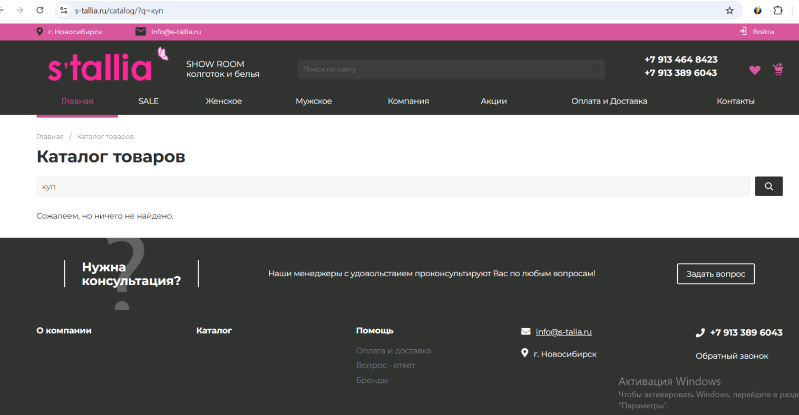
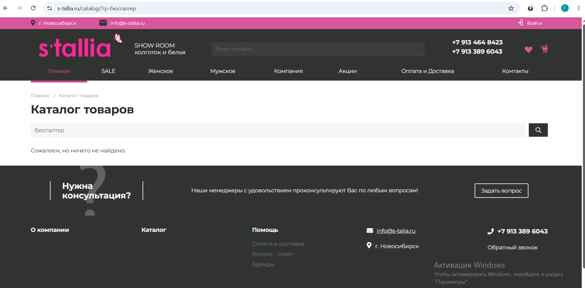
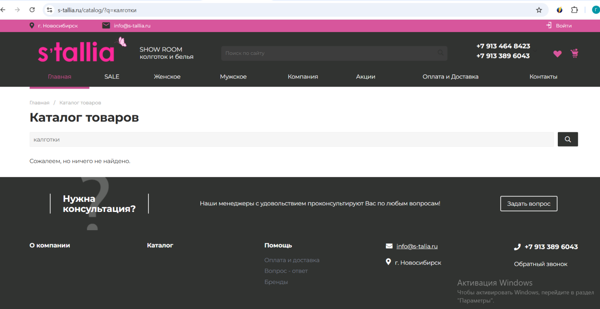

# Проект 4: Тестирование поиска (E-commerce)

**Задача:** Функциональное тестирование поисковой строки интернет-магазина.

## Что проверялось:
* Поиск по точному и частичному совпадению.
* Обработка опечаток и синонимов.
* Валидация пустого запроса.
* Удобство интерфейса поисковой строки.

## Найденные баги:
1. **BR-001 (Major):** Поиск не находит товары по частичному совпадению (префиксу). Например, запрос «куп» не находит категорию «Купальники».
   

2. **BR-002 (Major):** Поиск не обрабатывает опечатки. Запрос «бюсгалтер» выдает «Ничего не найдено» вместо исправления на «бюстгальтер».
   

3. **BR-003 (Major):** Поиск не обрабатывает синонимы. Запросы «лифчик» или «следки» не дают результатов.
   

## 📊 Материалы:
* [Скачать полный отчет](./tallia_report.xlsx)

*(Примечание: Чтобы ссылка на файл работала, вам нужно загрузить этот Excel-файл прямо в эту папку).*
